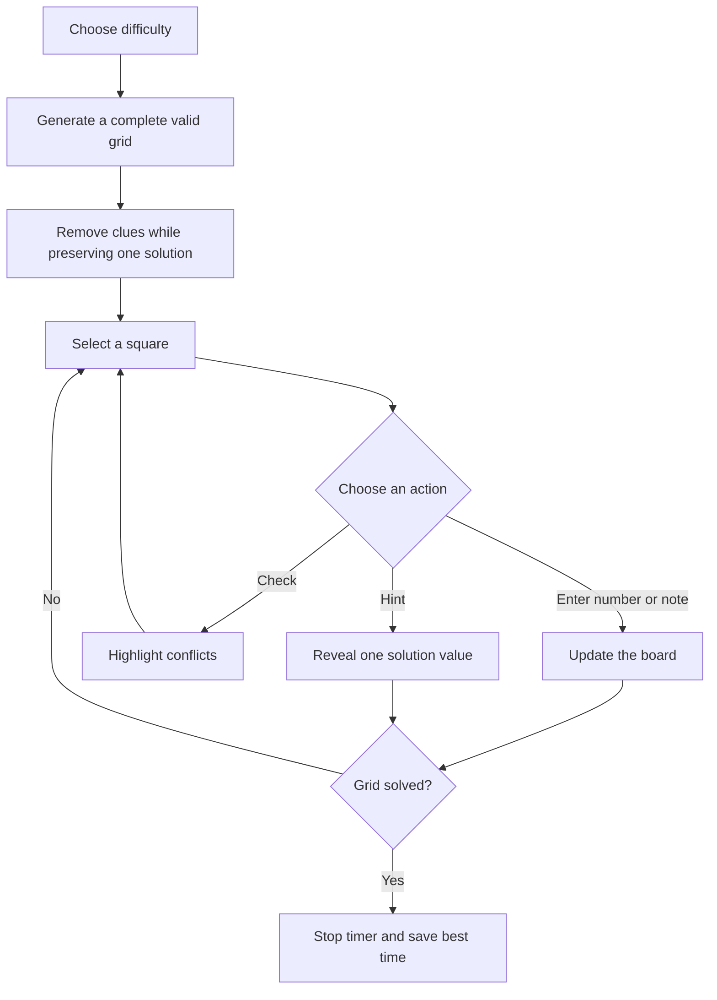

# Still Sudoku

A quiet, recruiter-ready Sudoku game built with Vue 3, TypeScript, and Vite. Every new puzzle is generated in the browser and checked to have a unique solution. Your best time is saved locally for each difficulty.

Play it at **https://oscarmmi.github.io/sudoku/**.

## How to play

- Choose **Easy**, **Medium**, or **Hard**, then fill each row, column, and 3×3 box with the numbers 1–9 exactly once.
- Select a square with a click or tap. Enter a number with your keyboard or the on-screen number pad.
- Use the **Notes** switch (or press `N`) to pencil in possibilities. Press `Delete` or `Backspace` to clear an entry.
- Arrow keys move the selected square. **Check board** highlights duplicates, and **Get a hint** reveals one correct number.
- Finish the grid to stop the timer and save a personal best for that difficulty.

## Run locally

```sh
npm install
npm run dev
```

Run the logic tests and production build:

```sh
npm test
npm run build
```

## Game loop


